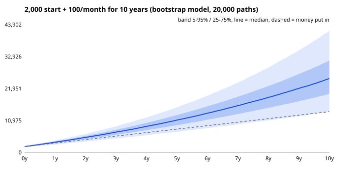

# Monte Carlo portfolio simulator

How much could a small portfolio with monthly contributions be worth in 10 years, and how bad can it get? This script simulates 20,000 futures for a portfolio that starts with €2,000 and adds €100 a month, using two return models:

- **GBM (lognormal):** monthly returns drawn from a normal distribution of log-returns, fitted to history.
- **Block bootstrap:** random 12-month blocks of *real* S&P 500 monthly returns (1985–2026) glued together. This keeps fat tails and crash clusters that the normal model smooths away.



## Result (default settings: €2,000 + €100/month, 10 years, seed 42)

| Model | Invested | 5th pct | Median | 95th pct | P(loss) | VaR 5% | CVaR 5% | Median max drawdown |
|---|---|---|---|---|---|---|---|---|
| GBM | 14,000 | 14,569 | 24,794 | 44,287 | 3.7% | +4.1% | −7.6% | −16.0% |
| Bootstrap | 14,000 | 13,977 | 25,370 | 41,811 | 5.1% | −0.2% | −15.1% | −21.8% |

**What the comparison shows:** both models give a similar median, but the bootstrap's bad tail is about twice as deep (CVaR −15% vs −8%) and its typical drawdown is larger. A normal-distribution model understates crash risk. That's the main reason to bootstrap real returns instead of assuming normality.

VaR/CVaR are measured on the total return of the money put in after 10 years. "Max drawdown" is the deepest peak-to-trough fall along each path, contributions included.

## Run it

```bash
python3 mc.py                                   # defaults above
python3 mc.py --start 5000 --monthly 250 --years 20 --paths 50000
python3 -m unittest discover -s tests -v        # 6 tests
```

Only needs `numpy`. Charts are written as plain SVG to `docs/` (no plotting library). `fetch_data.py` refreshes the data (needs `yfinance`).

## Methods

- **GBM:** log-returns ~ N(μ, σ²) per month with μ, σ estimated from the sample; a test checks the simulated mean against the closed form E[W_T] = exp(T(μ + σ²/2)).
- **Block bootstrap:** fixed blocks of 12 consecutive months, start points drawn uniformly. Blocks preserve short-range autocorrelation and volatility clustering.
- **Risk measures:** percentiles of final wealth, probability of ending below the amount invested, historical VaR/CVaR at 5%, maximum drawdown per path.

## Limitations

- The data is the S&P 500 **price index** (dividends excluded, ~1.5–2%/year), in USD, without fees, taxes or currency effects. Results are conservative on return and say nothing about a specific fund.
- 1985–2026 was a strong period for US stocks. Bootstrapping can only replay what's in the sample.
- Educational project, not investment advice.

## License
MIT
